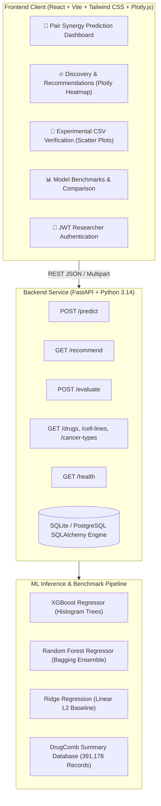

# 🧬 Cancer Drug Combination Prediction & Research Platform

[](https://fastapi.tiangolo.com)
[](https://reactjs.org/)
[](https://vitejs.dev/)
[](https://tailwindcss.com)
[](https://xgboost.readthedocs.io/)
[-teal.svg?style=flat)](https://drugcomb.org)

> **Research Disclaimer:** *Cancer Drug Combination Prediction & Research Platform is a computational framework designed to prioritize synergistic drug combinations for in-vitro wet-lab assay validation. It is not intended for clinical diagnosis, patient management, or clinical decision-making.*

---

## 📌 1. Project Overview & Problem Statement

Cancer remains one of the world's leading causes of mortality. Monotherapy often leads to acquired drug resistance and treatment failure. Combination chemotherapy and targeted agent pairings can overcome resistance through synergistic pathway inhibition.

However, screening all possible drug combinations in wet labs is astronomically expensive and slow (for just 100 approved agents, there are ~5,000 pairwise combinations). The **Cancer Drug Combination Prediction & Research Platform** addresses this challenge through machine learning:
- Screens drug pairs computationally using experimental dose-response data from **DrugComb (391,000+ screened experiments)**.
- Predicts the **Bliss Independence Synergy Score** and classifies responses into **Synergistic (Bliss > 10)**, **Additive (-10 ≤ Bliss ≤ 10)**, or **Antagonistic (Bliss < -10)**.
- Evaluates candidate combinations across 13 major cancer lineages (Melanoma, Breast, Lung, Colorectal, Prostate, Glioblastoma, Leukemia, etc.).
- Includes a dedicated **Lab Assay Verification Module** with statistical concordance metrics ($r$, RMSE, ROC-AUC).

---

## 🏗️ 2. System Architecture



---

## 📊 3. Empirical Model Benchmarks (Real DrugComb Data)

All models were evaluated using **5-Fold GroupKFold stratified by drug pair** to prevent data leakage (pairs in the test fold were never seen during training):

| Metric | XGBoost (Primary) | Random Forest | Ridge (Baseline) | Interpretation |
| :--- | :---: | :---: | :---: | :--- |
| **Pearson Correlation ($r$)** | **0.6291** | 0.6023 | 0.2687 | Linear concordance with wet-lab Bliss scores |
| **ROC-AUC** | **0.8105** | 0.7765 | 0.6139 | Discrimination power (Synergistic vs Non-synergistic) |
| **Synergy Precision** | **85.8%** | 83.8% | 0.0% | Reliability of predicted synergistic pairs |
| **RMSE** | **15.85** | 16.28 | 19.65 | Standard deviation of residual prediction errors |
| **MAE** | **10.95** | 11.41 | 15.41 | Mean absolute deviation |

---

## 🚀 4. Getting Started Locally

### Prerequisites
- Node.js 18+ (tested on Node v24)
- Python 3.10+ (tested on Python 3.14)

### 1. Start the FastAPI Backend
```bash
cd backend
python -m uvicorn app.main:app --port 8000 --reload
```
*Backend API Docs will be available at:* **`http://localhost:8000/docs`**

### 2. Start the React Frontend
```bash
cd frontend
npm run dev
```
*Web Platform will be live at:* **`http://localhost:5173/`**

---

## 🐳 5. Run with Docker & Docker Compose

Run the entire research platform (Backend + ML Engine + Frontend + Nginx) with a single command:

```bash
# 1. Build and launch all containers
docker compose up --build -d

# 2. View container status
docker compose ps

# 3. View live logs
docker compose logs -f
```

- **Frontend Application:** [http://localhost:5173](http://localhost:5173)
- **FastAPI Backend & Swagger API Docs:** [http://localhost:8000/docs](http://localhost:8000/docs)
- **Backend Health Check:** [http://localhost:8000/health](http://localhost:8000/health)

To stop the containers:
```bash
docker compose down
```

---

## 🌐 6. REST API Endpoints Reference

| Method | Endpoint | Query / Body | Description |
| :--- | :--- | :--- | :--- |
| `POST` | `/predict` | `{ drug_a, drug_b, cell_line }` | Predicts Bliss synergy score, response class, confidence, and SHAP weights |
| `GET` | `/recommend` | `?cancer_type=Melanoma&top_n=15` | Retrieves top prioritized synergistic pairs with Plotly matrix mapping |
| `POST` | `/evaluate` | Multipart `file` (.csv) | Calculates RMSE, MAE, Pearson $r$, ROC-AUC, and residual errors for lab assays |
| `GET` | `/drugs` | — | Returns list of supported pharmaceutical agents |
| `GET` | `/cell-lines` | — | Returns list of supported cancer cell lines |
| `GET` | `/cancer-types`| — | Returns categorized cancer types |
| `GET` | `/model-comparison` | — | Returns cross-model benchmark metrics |
| `POST` | `/auth/signup` | `{ name, email, password }` | Registers a new researcher account |
| `POST` | `/auth/login` | `{ email, password }` | Issues JWT authorization bearer token |
| `GET` | `/health` | — | Healthcheck status and ML model memory verification |

---

## 🧪 6. Sample CSV for Lab Assay Verification
To test the **Lab Evaluation** module, format your CSV with the following columns:
```csv
drug_a,drug_b,cell_line,actual_synergy
Dabrafenib,Trametinib,A375,28.4
5-FU,Cisplatin,HCT116,14.6
Olaparib,Temozolomide,MCF7,19.2
Venetoclax,Ibrutinib,K-562,22.8
Erlotinib,Gefitinib,A549,-12.4
Imatinib,Nilotinib,K-562,-8.7
```

---

## 📦 7. Deployment Instructions

### Frontend (Vercel)
1. Push repository to GitHub.
2. Link project on [Vercel](https://vercel.com) with root directory set to `frontend`.
3. Set environment variable: `VITE_API_URL=https://your-backend.onrender.com`.

### Backend (Render)
1. Link repository to [Render](https://render.com) as a Web Service.
2. Root directory: `backend`.
3. Build command: `pip install -r requirements.txt`.
4. Start command: `uvicorn app.main:app --host 0.0.0.0 --port $PORT`.

---

## 📜 8. License & Acknowledgments
- Dataset provided by the **DrugComb Consortium** (Zenodo open access).
- Reference baseline algorithms derived from the **DREAM7 / O'Neil et al.** challenge.
- Built for academic and oncological research applications.
