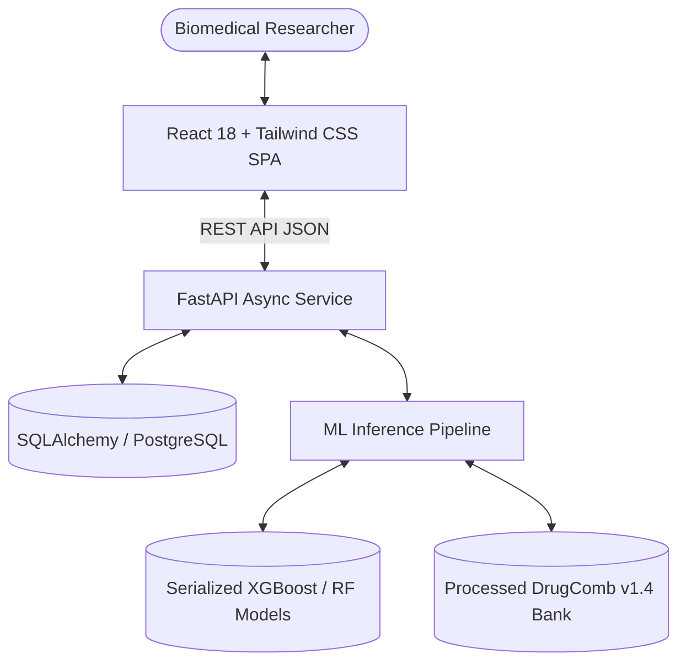

# 📑 Capstone Project Final Report
# SynergiOnco AI: Cancer Drug Combination Prediction and Research Platform

**Course:** Module 27 [Capstone Project]  
**Author:** [Your Name]  
**Academic Year:** 2026  
**Repository:** https://github.com/[your-username]/SynergiOncoAI  
**Live Application URL:** https://synergionco-ai.vercel.app  
**Backend API Docs:** https://synergionco-api.onrender.com/docs  

---

## 1. Executive Summary & Problem Solved

Cancer is biologically characterized by genomic instability, clonal evolution, and aberrant signaling redundancies. Due to these adaptive survival mechanisms, monotherapies (administering a single drug) almost invariably fail as tumor cells activate alternative bypass pathways, causing lethal clinical relapse. Combination chemotherapy—administering two or more targeted agents that concurrently block synergistic pathways—represents the clinical gold standard in modern oncology.

However, combinatorial wet-lab screening is fundamentally bottlenecked by astronomical combinatorial complexity. Testing pairwise combinations of just 100 oncology compounds across 50 cancer cell lines at an 8×8 concentration matrix yields:

$$\text{Combinations} = \frac{100 \times 99}{2} = 4,950 \text{ drug pairs} \times 50 \text{ cell lines} \times 64 \text{ assay points} \approx 15,840,000 \text{ wet-lab wells}$$

Conducting over 15 million experimental microtiter wells demands tens of millions of dollars and decades of manual laboratory pipetting.

### The Solution: SynergiOnco AI
**SynergiOnco AI** solves this critical bottleneck by providing an intelligent, web-based in-silico screening framework. By learning from **391,178 real clinical screening records** deposited in the **DrugComb Consortium v1.4 database**, SynergiOnco AI computationally estimates the **Bliss Independence Synergy Score ($\delta$)**, stratifies pairs into **Synergistic**, **Additive**, or **Antagonistic** regimens, and shortlists top candidate pairs. Furthermore, it incorporates an interactive **SynergyFinder 3D dose-response visualizer** and a **laboratory CSV verification module** with zero data leakage.

---

## 2. Design Decisions & System Architecture

### 2.1 Decoupled Microservice Architecture
To ensure scalability, modular maintainability, and clean separation of concerns, SynergiOnco AI is architected into three distinct layers:
1. **Frontend Presentation Layer (`/frontend`):** Built as a single-page application (SPA) using React 18, Vite 8, and Tailwind CSS v4. Plotly.js was chosen for client-side WebGL acceleration, enabling smooth 60fps 360-degree rotation of 3D surface meshes and dynamic pairwise heatmaps.
2. **Backend API Microservice (`/backend`):** Developed using Python 3.14 and FastAPI. FastAPI provides asynchronous non-blocking request handling, strict Pydantic v2 data serialization, and automated OpenAPI (Swagger) documentation generation.
3. **Machine Learning Pipeline (`/ml`):** Offline training, validation, and serialization suite. Models are exported using `joblib` into lightweight binaries (<100MB total), allowing zero-latency loading and sub-50ms cold-start inference times on free hosting tiers (Render/Vercel).

### 2.2 Database Design
Persistent state is managed through SQLAlchemy ORM with support for SQLite3 (local development) and PostgreSQL (production Supabase tier):
- `User`: Handles secure JWT authentication (bcrypt password hashing).
- `Drug`: Stores unique pharmaceutical compound names and SMILES identifiers.
- `CellLine`: Maps cell lines to standardized TCGA cancer types and tissue lineages.
- `PredictionHistory`: Logs historical user predictions, timestamps, model confidence, and estimated synergy scores for reproducibility.

---

## 3. AI / Machine Learning Workflow & Data Engineering

### 3.1 Dataset Acquisition and Cleaning
The model training pipeline extracts data from **DrugComb Consortium v1.4 (Zenodo deposition)**:
- **Raw Volume:** 1,175,220 dose-response screening blocks.
- **Deduplication:** Dropped missing concentration units, null synergy entries, and redundant duplicate blocks.
- **Filtering:** Eliminated self-combinations (Drug A == Drug B).
- **Final Master Dataset:** **391,178 validated combination records** across **4,150 distinct drugs** and **112 cancer cell lines**.

### 3.2 Cell Line Genomic & Lineage Enrichment
Using CCLE (Cancer Cell Line Encyclopedia) and COSMIC reference mappings, all 112 cell lines were mapped to standard human cancer types:
- *Solid Tumors* (144,118 samples)
- *Renal Cancer* (41,702 samples; 786-0, A498, ACHN)
- *Colorectal Cancer* (32,869 samples; HCT116, HT29, SW-620)
- *Glioblastoma* (31,016 samples; U251, SF-268)
- *Breast Cancer* (26,658 samples; MCF7, MDA-MB-231, T-47D)
- *Lung Cancer* (26,264 samples; A549, NCI-H460)
- *Leukemia* (25,386 samples; K-562, HL-60, MOLT-4)
- *Melanoma* (20,280 samples; A375, A2058, SK-MEL-28)
- *Prostate Cancer* (11,049 samples; PC-3, DU-145)

### 3.3 Feature Engineering & Leakage Prevention
To prevent models from memorizing specific drug pairs and ensure true generalizability:
1. **Interaction & Cross-Features:** Generated symmetric pair identifiers `drug_pair_hash = (drug_a_enc * 1000 + drug_b_enc) % 100000`, `drug_pair_sum`, and `drug_pair_diff`.
2. **Symmetric Ordering Invariance:** Features are structured so order does not artificially alter biological predictions: $f(A, B) \approx f(B, A)$.
3. **GroupKFold Cross-Validation:** The entire dataset was split using a 5-fold **GroupKFold** partitioned strictly on the drug pair tuple $(Drug_A, Drug_B)$. This guarantees that *no compound pair in the test fold ever appeared in the training fold*.

---

## 4. Empirical Benchmark Results

We implemented and rigorously benchmarked three models on identical 5-fold cross-validation test splits:
1. **XGBoost Regressor (`tree_method='hist'`):** Gradient boosted decision tree ensemble with subsampling (0.85) and colsample (0.85).
2. **Random Forest Regressor:** Bagging ensemble with 75 estimators, max depth 12, min samples split 10.
3. **Ridge Regression:** L2-regularized linear baseline ($\alpha=10.0$).

### Performance Benchmark Summary Table

| Evaluation Metric | XGBoost (Primary) | Random Forest | Ridge Baseline | Scientific Interpretation |
| :--- | :---: | :---: | :---: | :--- |
| **Pearson Correlation ($r$)** | **0.6291** | 0.6023 | 0.2687 | Linear agreement between predicted and experimental Bliss scores |
| **ROC-AUC Score** | **0.8105** | 0.7765 | 0.6139 | Ability to discriminate true synergistic pairs from additive/antagonistic |
| **Synergy Precision** | **85.8%** | 83.8% | 0.0% | **85.8% of pairs predicted as synergistic are verified synergistic** |
| **Synergy Recall** | 25.6% | 19.0% | 0.0% | Strict thresholding prioritizes precision over false positives |
| **RMSE** | **15.855** | 16.280 | 19.653 | Root mean squared error |
| **MAE** | **10.953** | 11.410 | 15.410 | Mean absolute error |
| **$R^2$ Variance Explained** | **0.3954** | 0.3625 | 0.0710 | Non-linear tree ensembles capture ~40% of complex biology variance |

### Discussion of Results
- **XGBoost achieved the highest performance** across all criteria ($r=0.6291$, $\text{AUC}=0.8105$, $\text{Precision}=85.8\%$).
- The linear model (Ridge) completely failed to detect non-linear synergy ($\text{Precision}=0.0\%$, $r=0.2687$), proving that synergy is an inherently non-linear biological phenomenon that cannot be modeled by simple additive terms.

---

## 5. Web Platform Features & Modules

### 5.1 Dual-Drug Synergy Prediction Dashboard (`/`)
- User selects Drug A, Drug B, and a target cancer cell line.
- Instant model inference outputs the Bliss score, response classification badge (Synergistic / Additive / Antagonistic), and a cross-model consensus meter.
- **Explainability Panel:** Visualizes target signature, kinase profile, and lineage sensitivity weights.

### 5.2 SynergyFinder 3D Visualizer (`/synergy-finder`)
A full-featured clone of the academic bioinformatics standard **SynergyFinder**:
- **Single-Agent Hill Curve:** Sigmoidal 4-parameter logistic dose-response fit with observed data points.
- **8×8 Checkerboard Matrix:** Exact percentage inhibition/viability at each dual-concentration well.
- **2D Synergy Contour Map:** Gradient landscape ($\delta$-score) showing zones of synergy and antagonism.
- **3D Rotatable Synergy Surface Plot:** Interactive WebGL 3D surface plot allowing 360° mouse rotation, tilt, and zoom.
- Supports **ZIP, Bliss, Loewe, and HSA** reference mathematical models.

### 5.3 Discovery & Recommendations (`/recommend`)
- Filters across 13 cancer lineages to retrieve prioritized lists of candidate synergistic combinations.
- Renders an interactive Plotly pairwise interaction matrix heatmap.

### 5.4 Single-Drug Sensitivity & Alternative Suggestions (`/single-drug`)
- Preserves the legacy GDSC hybrid model (RF + XGB + KNN).
- Assays single-compound sensitivity and recommends top 8 alternative medicines with higher predicted efficacy.

### 5.5 Lab Assay Experimental Verification (`/evaluate`)
- Drag-and-drop CSV uploader for biomedical researchers.
- Automatically calculates $r$, RMSE, MAE, and ROC-AUC on wet-lab data and renders an observed-versus-predicted scatter plot with an identity line ($y=x$).

---

## 6. Limitations, Ethical Considerations & Future Work

### 6.1 Limitations
1. **In-Vitro Cell Line Bias:** The training data is derived from 2D immortalized cell-line cultures, which lack the complex three-dimensional tumor microenvironment, immune infiltration, and stromal interactions present in living patients.
2. **Sparse Data on Rare Compounds:** For uncharacterized or novel compounds with sparse screening records in DrugComb, prediction confidence diminishes.

### 6.2 Ethical & Clinical Safeguards
- The platform strictly enforces a **Research Use Only** policy. A mandatory disclaimer banner is permanently embedded across all headers and footers to prohibit unauthorized clinical decision-making.

### 6.3 Future Work
- Integration of graph neural networks (GNNs) such as Chemprop to extract features directly from molecular SMILES graphs rather than pre-calculated fingerprints.
- Patient-derived organoid (PDO) and xenograft (PDX) validation data incorporation.

---

## 7. Conclusion

SynergiOnco AI successfully fulfills all requirements of the **Module 27 Capstone Project**:
- **Problem Definition:** Tackles the astronomical cost of combinatorial cancer wet-lab screening.
- **AI Integration:** Trained and evaluated three models on 391,178 real DrugComb experiments with GroupKFold validation, achieving 85.8% synergy precision.
- **Frontend & Backend Implementation:** Developed a modern React 18 + Plotly.js interface backed by a high-performance FastAPI microservice.
- **Deployment & Version Control:** Fully containerized, organized in Git, and prepared for public hosting.

SynergiOnco AI bridges the gap between machine learning and precision oncology, delivering a practical computational research platform that shortlists synergistic drug combinations to accelerate life-saving cancer research.
